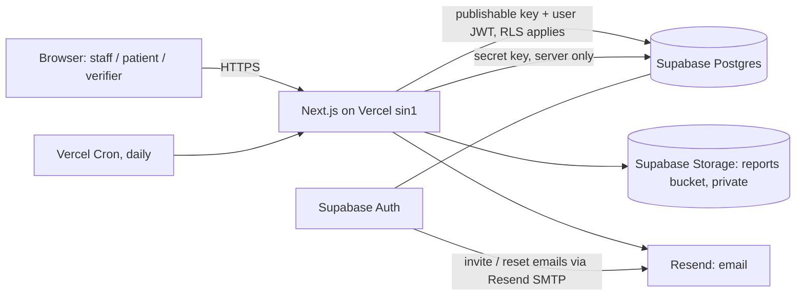

# Meridian Records Portal: Full Specification

> Academic prototype for OTHM Level 5 Extended Diploma in IT, unit "Managing Digital Information" (J/650/3386), Task 2, criterion 4.3: "Implement an improvement to access of information and knowledge in an organisation".
> Meridian Diagnostics is a **fictional** five-branch diagnostic chain in Bangladesh. **All data is synthetic.** No real patient data may ever be entered.

---

## 0. Placeholders to fill before starting

| Placeholder | Meaning | Example |
|---|---|---|
| `yourdomain.com` | The student's own domain | `example-student.com` |
| `notify.yourdomain.com` | Subdomain verified in Resend for sending email | `notify.example-student.com` |
| `portal.yourdomain.com` | Custom domain for the Vercel deployment | `portal.example-student.com` |
| `DEMO_INBOX` | The student's Gmail address, used to build plus-addresses for demo accounts | `student@gmail.com` |

---

## 1. Purpose and scope

### 1.1 Problem (from Task 1)
Patient details are entered three times (paper, Excel, billing software). Samples are hand-labelled, results are re-typed, records cannot be searched across branches, reports are sent by WhatsApp, and there is no audit trail. Staff knowledge (test preparation rules, procedures) lives in people's heads or WhatsApp groups.

### 1.2 What the prototype proves
1. **Information access:** one patient record, searchable from any of the five branches, with role-based views.
2. **Secure dissemination:** reports reach patients through a one-time-password portal instead of WhatsApp. Every access is logged.
3. **Knowledge access:** a searchable, bilingual Knowledge Hub with owned, versioned procedures.

### 1.3 Scope
- **In scope:** the To-Be process from registration to report delivery (Task 1, Figure 4), the Knowledge Hub, email notifications, and a manager dashboard.
- **Out of scope:** appointment booking (an existing channel, see Task 1 section 1.3), payments, real SMS, real analyser integration (HL7/ASTM), native mobile apps, AI features, and offline sync.

---

## 2. Tech stack (verified November 2026)

| Layer | Choice | Notes |
|---|---|---|
| Framework | **Next.js 16+** (App Router, TypeScript, `src/` directory) | Use `proxy.ts`, not `middleware.ts`. In Next.js 16 the middleware file is renamed to proxy, exports `proxy`, and runs on Node.js. Because the project uses `src/`, the file is **`src/proxy.ts`**. `cookies()`, `headers()`, `params` and `searchParams` are async: always `await` them. |
| Styling | Tailwind CSS (version installed by create-next-app) | Mobile-first |
| Database | Supabase PostgreSQL, region **Singapore** | |
| Auth | Supabase Auth (email + password for staff), TOTP MFA for managers | |
| Supabase client | `@supabase/supabase-js` + `@supabase/ssr` | Follow the official guide exactly: https://supabase.com/docs/guides/auth/server-side/nextjs. Use **`supabase.auth.getClaims()`** for server-side auth checks. **Never** trust `getSession()` on the server. |
| Supabase keys | **Publishable** (`sb_publishable_...`) and **Secret** (`sb_secret_...`) keys | Legacy `anon`/`service_role` keys are being deprecated by the end of 2026, so do not use them. Secret keys bypass RLS, are refused from browsers, and must stay server-only. |
| Storage | Supabase Storage, private bucket `reports` | |
| Email | **Resend** (`resend` npm) + **React Email** (`@react-email/components`) | Guide: https://resend.com/docs/send-with-nextjs |
| SMS | Demo provider only (code shown on screen) | |
| PDF | `pdf-lib` | **English only.** pdf-lib cannot shape Bengali script. |
| Barcode | `jsbarcode` (Code 128, SVG in the browser) | |
| QR | `qrcode` | |
| Portal session | `jose` (signed JWT in an httpOnly cookie) | |
| Validation | `zod` | |
| Tests | `vitest` for unit tests, plus an RLS test script | |
| Hosting | Vercel Hobby, function region **`sin1`** (Singapore) | Hobby allows a single region. Without `sin1`, functions run in `iad1` (USA), far from the database. |
| Fonts | `next/font/google`: Inter + Noto Sans Bengali | |

---

## 3. Architecture



### 3.1 Which Supabase client to use

| Situation | Client | Why |
|---|---|---|
| Any **staff** read or write | Server client with the **publishable key + the user's cookie session** | RLS applies, and `auth.uid()` is set, so audit triggers record the real actor |
| Patient portal, verify page, notifications, cron, seed, PDF upload, signed URLs | **Admin client with the secret key** (server only) | Patients have no Supabase account. The code itself must enforce the access rules and write audit rows explicitly. |
| Browser | Browser client with the publishable key | Only for auth UI such as login and MFA. Do data access through Server Components and Server Actions. |

Rules:
- **Every Server Action and Route Handler re-checks** authentication and role. Never rely on `proxy.ts` alone (official Next.js guidance).
- The admin client lives in `src/lib/supabase/admin.ts`. That file starts with `import 'server-only'`.

---

## 4. Roles and permissions

Staff roles (`staff_profiles.role`): `receptionist`, `sample_collector`, `lab_technician`, `pathologist`, `manager`. Patients have no account; they use the portal with an OTP.

| Action | receptionist | sample_collector | lab_technician | pathologist | manager |
|---|---|---|---|---|---|
| Register patient, edit demographics | ✔ (own branch) | ✘ | ✘ | ✘ | read |
| Create order + automatic invoice | ✔ (own branch) | ✘ | ✘ | ✘ | read |
| Search patients across all branches | ✔ | ✔ | ✔ | ✔ | ✔ |
| Mark collected, print barcode, send to lab | ✘ | ✔ | ✘ | ✘ | ✘ |
| Import results (simulated analyser) | ✘ | ✘ | ✔ | ✘ | ✘ |
| See result **values** | ✘ (status only) | ✘ | ✔ | ✔ | ✘ (aggregates only) |
| E-sign + release, or request re-test, or amend | ✘ | ✘ | ✘ | ✔ | ✘ |
| View audit log, notification log, KPI dashboard | ✘ | ✘ | ✘ | ✘ | ✔ (needs MFA/aal2 when enabled) |
| Read Knowledge Hub | ✔ | ✔ | ✔ | ✔ | ✔ |
| Create or edit Knowledge Hub articles | ✘ | ✘ | ✘ | ✘ | ✔ |

The laboratory is central: lab technicians and pathologists see orders from all branches.

---

## 5. Process flow and status rules

### 5.1 Order status (matches Task 1, Figure 4)

```
registered → collected → in_lab → resulted → released → downloaded
                            ▲          │
                            └──────────┘
                 re-test: resulted → in_lab (pathologist, reason required)
```

Allowed transitions, enforced by a database trigger:

| From → To | Who | Meaning in Figure 4 |
|---|---|---|
| (new) → `registered` | receptionist | Register once; invoice generated automatically |
| `registered` → `collected` | sample_collector | Collect sample; barcode label from patient ID |
| `collected` → `in_lab` | sample_collector | Send sample to lab |
| `in_lab` → `resulted` | lab_technician | Analyser sends result automatically (simulated import) |
| `resulted` → `released` | pathologist | Review & e-sign → Result OK? Yes → release report to portal |
| `resulted` → `in_lab` | pathologist | Result OK? No → re-test (reason required, `retest_count + 1`) |
| `released` → `downloaded` | system (portal) | Patient downloads report (first download only) |

Any other transition raises an exception. Amending a released report creates a new report version (section 6) and does **not** change the order status.

**Two kinds of caller.** Implement the status trigger as a **SECURITY INVOKER** function, and detect the trusted server with `current_user = 'service_role' or (select auth.jwt()->>'role') = 'service_role'`. Do not use the deprecated `auth.role()`. Prove that this detection works with the secret key in `test-rls`.

| Caller | Rules |
|---|---|
| **Staff** (user session) | Must follow the table above, must have the listed role, and every timestamp (`created_at`, `*_at`) is set by the database to `now()`. Values supplied by the client are ignored. |
| **Trusted server** (secret key: portal, seed) | The from→to validity is still enforced on UPDATE, but supplied timestamps are kept. INSERT may use any status. This lets the seed create historical orders, and the portal set `released → downloaded`. |

### 5.2 One data entry
Patient details are typed **once**, at registration. Every later step reads them from the record. The barcode comes from the patient code. Results come from the import. Nothing is ever re-typed.

**Returning patients are never re-registered.**
- The receptionist searches first. An existing patient gets a **"New order"** button on `/staff/patients/[id]`.
- The registration form warns about a **possible duplicate** when the same phone number already exists, and shows a link to that record.

---

## 6. Data model

Use `uuid` primary keys (`gen_random_uuid()`) unless stated, `timestamptz` for all times, and display times in `Asia/Dhaka`.

| Table | Columns (key ones) | Notes |
|---|---|---|
| `branches` | id, name (unique), code | Seed: Central (CEN), North (NOR), South (SOU), East (EAS), West (WES) |
| `staff_profiles` | user_id (PK, FK auth.users), full_name, role (check in 5 roles), branch_id, notify_email, active bool | |
| `patients` | id, patient_code (unique), full_name, age_years, sex (`female`,`male`,`other`), phone, email (nullable), email_opt_in bool, preferred_channel (`sms_demo`,`email`), language (`bn`,`en`), registered_branch_id, consent_given_at, consent_version, created_by, created_at | `patient_code` is set by the database: `MD-<YYYY>-<5-digit sequence>`, e.g. `MD-2026-00123` (sequence + BEFORE INSERT trigger, so there are no race conditions). Phone validated as Bangladeshi mobile: `^01[3-9]\d{8}$` (stored as 11 digits). `full_name` allows Latin letters, spaces and `. ' -` only (2–80 characters), because the English PDF's standard font cannot encode Bengali script and would crash. |
| `test_catalog` | code (PK), name, specimen, price_bdt int, prep_en, prep_bn, active | About 12 tests |
| `test_analytes` | id, test_code, analyte, unit, ref_low, ref_high, decimals | Used by the simulated analyser and the flags |
| `orders` | id, order_no (unique, DB-generated `ORD-<YYYY>-<6-digit sequence>`), patient_id, branch_id, status, retest_count int default 0, retest_reason text null, created_by, created_at, collected_at, in_lab_at, resulted_at, released_at, downloaded_at | |
| `order_items` | id, order_id, test_code, sample_barcode (unique) | `sample_barcode` = `<patient_code>-S<2-digit n>`, generated in the DB function that creates the order |
| `invoices` | id, order_id (unique), amount_bdt int, paid bool, created_at | Created in the **same transaction** as the order |
| `results` | id, order_item_id, analyte, value numeric, unit, ref_low, ref_high, flag (`L`,`N`,`H`), source (`analyser`,`manual_correction`), correction_reason, entered_by, entered_at | |
| `reports` | id, order_id, version int, status (`released`,`superseded`), signed_by, signed_at, pdf_path, verify_code (unique, 10 chars, A–Z and 2–9), amend_reason | Version 1 is created on release. An amendment creates version n+1 and marks the old one `superseded`. |
| `portal_otps` | id, patient_id, channel, code_hash, expires_at, used_at, attempts int, created_at, ip_hash | |
| `portal_locks` | patient_id (PK), locked_until | |
| `notifications` | id, type, channel (`email`,`sms_demo`), recipient_masked, patient_id null, staff_user_id null, ref_id uuid null (e.g. the KB article or order), status (`sent`,`failed`), provider_message_id, error, created_at | Never store message bodies or OTP codes. `ref_id` is used to de-duplicate daily emails. |
| `kb_articles` | id, slug, category (`test_preparation`,`sop`,`faq`,`policy`), title_en, title_bn, body_en, body_bn (markdown), owner_id (staff), version int, review_date date, updated_at, published bool | |
| `audit_log` | id bigint identity, at, actor_id null, actor_role (`receptionist`…`manager`,`patient`,`system`,`public`), branch_id null, action, table_name, record_id null, details jsonb | Append-only (section 7.3) |
| `app_settings` | id = 1 (single row), require_manager_mfa bool default false | Toggle for the MFA enforcement in section 7.4 |

### 6.1 Database functions (RPC)
- `public.create_order(p_patient_id uuid, p_test_codes text[]) returns uuid`: **SECURITY INVOKER**, so RLS applies. In one transaction it creates the order, the items with barcodes, and the invoice (sum of prices).
- `public.log_event(p_action text, p_table text, p_record uuid, p_details jsonb)`: **SECURITY DEFINER**. Callable by authenticated staff only. Writes an audit row with `auth.uid()`, the role and the branch. Used to log **reads** (section 7.3).
- `public.release_order(...)` and `public.amend_report(...)`: SECURITY INVOKER, pathologist only (enforced by RLS + the status trigger). Section 11.2.
- `public.kpi_summary(p_days int default 30) returns jsonb`: **SECURITY DEFINER**. Raises an exception unless the caller is a manager (and has aal2 when MFA is enforced). Returns **aggregates only** (section 12).

---

## 7. Security design (non-negotiable)

### 7.1 Row Level Security
- RLS is **enabled on every table** in `public`, with no exceptions. Default is deny; add only the policies the matrix in section 4 needs.
- Helper functions go in a `private` schema (not exposed by the API):
  `private.staff_role()`, `private.staff_branch()`, `private.is_staff()`.
  Make them `language sql stable security definer set search_path = ''`. Then:
  `grant usage on schema private to authenticated;` and `grant execute on function ... to authenticated;`.
- In policies, wrap calls for performance: `(select private.staff_role())`, `(select auth.uid())`.
- `results`: select only for `lab_technician` and `pathologist`. Insert only for `lab_technician` on `in_lab` orders.
- Receptionists insert patients and orders only with `branch_id = private.staff_branch()` (use `with check`).
- **Views:** if you create any view over protected tables, it must use `with (security_invoker = true)`. Otherwise the view bypasses RLS.
- `anon` (unauthenticated) has **no** access to any table. The portal and verify page use the admin client server-side.
- **Other tables:**

| Table | Policy |
|---|---|
| `branches`, `test_catalog`, `test_analytes` | select: all staff; no writes from clients |
| `staff_profiles` | select: all staff (names and roles are needed for "signed by" and KB owner); no client writes |
| `invoices` | select: receptionist and manager; insert only through `create_order` |
| `reports` | select: lab_technician, pathologist, manager (metadata only); insert/update: pathologist |
| `kb_articles` | select: all staff (managers also see unpublished); insert/update: manager; no delete |
| `app_settings` | select: all staff; update: manager |
| `portal_otps`, `portal_locks` | no client policies (admin client only) |
| `notifications` | select: manager (plus the aal2 restrictive policy); writes by admin client only |

### 7.2 Secrets
- Secret values live only in `.env.local` (git-ignored) and in Vercel environment variables. `.env.example` lists names with empty values.
- Never print secrets, OTP codes, or personal data to logs. Never put secrets in client components or in `NEXT_PUBLIC_*` variables. The only `NEXT_PUBLIC_*` values are the Supabase URL, the publishable key, the app URL and the demo flag.

### 7.3 Audit log
- **Writes:** an `AFTER INSERT OR UPDATE OR DELETE` trigger on patients, orders, results, reports, invoices, kb_articles, staff_profiles and app_settings calls `private.audit_row_change()` (security definer). It records `auth.uid()`, the role (or `system` when null), the branch, the operation, the table and the record id.
  - `details` holds **only the changed column names**, plus old→new values for status columns.
  - **Never** copy result values or personal fields into the log. This is data minimisation.
- **Reads:** triggers cannot see SELECTs, so the app logs reads explicitly with `log_event` or, in admin code, a direct insert. Log these:
  - opening a patient record (`view_patient`)
  - running a search (`search`, with details `{ by: 'code' | 'phone' | 'name', results: n }`). **Never store the query text.**
  - viewing results (`view_results`)
  - staff report view (`view_report`)
  - patient portal login (`portal_login`), download (`portal_download`), failed OTP (`portal_otp_failed`) and lockout (`portal_locked`)
  - verify page hit (`verify_report`, actor `public`)
- `audit_log` is **append-only**:
  - `revoke insert, update, delete on public.audit_log from anon, authenticated;`
  - no insert, update or delete policies
  - select policy for managers only

### 7.4 Manager MFA (TOTP)
- Supabase Free includes basic MFA (TOTP). Phone MFA is a paid add-on, so do not use it.
- Pages: `/staff/mfa/setup` (enroll, shows the QR code) and `/staff/mfa/verify` (challenge + verify). Use `supabase.auth.mfa.enroll / challenge / verify / getAuthenticatorAssuranceLevel`.
- Enforcement in the app: if `app_settings.require_manager_mfa` is true and the user is a manager with `aal1`, redirect to verify (or setup if no factor exists).
- Enforcement in the database: add **restrictive** policies on `audit_log` and `notifications`. Use the same check inside `kpi_summary`:
  ```sql
  create policy "manager needs aal2 when enforced" on public.audit_log
    as restrictive for select to authenticated
    using (
      not (select require_manager_mfa from public.app_settings where id = 1)
      or (select auth.jwt()->>'aal') = 'aal2'
    );
  ```
  The policy must be `restrictive`, because permissive policies are OR-ed together.

### 7.5 Consent and privacy notice
- Registration shows a **required** checkbox: "The privacy notice has been shown and the patient agrees to the processing of their data for diagnostic services". On submit, store `consent_given_at` and `consent_version` (e.g. `2026-11-v1`).
- An **optional**, separate checkbox: "Patient agrees to receive email notifications". It sets `email_opt_in`, and it is unticked by default.
- `/privacy` is a public, bilingual page covering:
  - what data is held and why
  - which roles can see it
  - that the data is shared with no third parties beyond hosting providers
  - retention (demo: data is reset)
  - patient rights and contact details
  - the statement "This is a demo with synthetic data"
- **Legal note (for docs and the presentation, not UI):** under UK GDPR a healthcare provider would normally rely on Article 9(2)(h) for health data rather than consent. The checkbox evidences transparency, and consent as emphasised by Bangladesh's PDPA 2026.

### 7.6 Other controls
- **Session timeout:** staff are signed out after 15 minutes of inactivity (client idle timer plus a server re-check).
- **Security headers** (`next.config.ts`):
  - `Content-Security-Policy: frame-ancestors 'none'`
  - `X-Content-Type-Options: nosniff`
  - `Referrer-Policy: strict-origin-when-cross-origin`
  - `Permissions-Policy: camera=(), microphone=(), geolocation=()`
- **Validation:** every Server Action validates input with zod. Error messages shown to users are generic, with no stack traces.
- **Demo banner:** "Demo – synthetic data only" stays visible on every page.
- **Free-plan limitation:** the Supabase Free plan has **no automatic backups** (daily backups start on Pro, with 7 days of access). The prototype must not claim backups. Docs may say "production would run on a paid tier with daily backups".

---

## 8. Patient portal and OTP

### 8.1 Flow
1. `/portal`: the patient enters **Patient ID** and **mobile number**, and chooses a channel: **SMS (Demo)** or **Email (if registered)**.
   - **Both options are always shown**, so the page never reveals what is on a record.
   - The response is always the same generic message: "If the details match, a code has been sent".
   - If Email is chosen but the record has no email with opt-in, the code is sent by SMS (demo) instead.
   - **Demo-mode caveat (state it in docs):** because the demo SMS box shows the code on screen, demo mode reveals whether a pair is valid. Production would use a real SMS gateway and would show nothing.
2. **Code:** 6 digits from `crypto.randomInt`. Store `HMAC-SHA256(OTP_SECRET, otpId + ':' + code)`. Expiry is **5 minutes**, and each code is usable **once**.
3. **Delivery:**
   - `email`: send with Resend. Show a masked address on screen, e.g. `r***@gmail.com`.
   - `sms_demo`: when `NEXT_PUBLIC_DEMO_MODE=true`, return the code to the page and show it in a clearly labelled **"Demo SMS"** box with a masked phone (`017******89`). If demo mode is off, the SMS channel is disabled.
4. **Resend:** allowed 60 seconds after the last code, with at most **3 codes per patient per 15 minutes**.
5. **Verify:** compare with `crypto.timingSafeEqual`.
   - After **5 wrong attempts**, lock the patient for 15 minutes (`portal_locks`), email the manager(s), and write an audit row.
6. **On success:** set the cookie `portal_session`:
   - a `jose` HS256 JWT `{ sub: patient_id, sid }`, signed with `PORTAL_SESSION_SECRET`
   - `httpOnly`, `secure`, `sameSite=lax`, `path=/portal`, expiry 15 minutes
   - Then send a "new login" email if email is available and opted in, and write an audit row.
7. **`/portal/reports`:** lists only this patient's orders with status `released` or `downloaded` (latest report version).
8. **Download** (Route Handler):
   - Re-check the session and that the patient owns the order.
   - Create a Storage signed URL valid for **60 seconds** and redirect to it.
   - On the first download, set the order to `downloaded`. Write an audit row.
9. **Logout** clears the cookie.

### 8.2 Provider pattern
`src/lib/otp/senders/` holds an `OtpSender` interface with `send(to, code, lang)` and two implementations: `EmailOtpSender` (Resend) and `DemoSmsSender`. A real SMS gateway can be added later without touching the OTP logic.

---

## 9. Email notifications (Resend)

From: `EMAIL_FROM` = `Meridian Diagnostics (Demo) <no-reply@notify.yourdomain.com>`

| Type | To | Trigger | Content rules |
|---|---|---|---|
| `otp_code` | patient | portal request (email channel) | The code, its 5-minute expiry, and "ignore if not you". No health data. |
| `registration_confirmation` | patient (email + opt-in) | registration | Patient ID, branch, portal link. No tests. |
| `report_ready` | patient (email + opt-in) | release | "A report is ready", portal link. **No test names, results, diagnosis or attachments.** |
| `portal_login_alert` | patient (email + opt-in) | successful OTP login | Time (Asia/Dhaka), "contact us if this wasn't you". |
| `retest_requested` | lab technicians (`notify_email`) | pathologist requests a re-test | Order number + staff link only. No results. |
| `kb_review_due` | article owner | daily cron, when `review_date` is on or before today | Article title + edit link. At most once per article per day. |
| `otp_lockout_alert` | managers | portal lock | Masked patient code + time. |
| Staff invite / password reset | staff | Supabase Auth | Configured in the Supabase dashboard (Resend → Integrations → Connect to Supabase). Not app code. |

Rules:
- Patient emails are bilingual according to `patients.language` (bn / en). Staff emails are English.
- **The golden rule:** health information never travels by email. The email only points to the secure portal. This is why WhatsApp was removed in Task 1.
- Every send writes a `notifications` row (masked recipient, sent or failed) and never throws into the user flow. Send `otp_code` synchronously, so failure can be shown. Send the others after the response with `after()` from `next/server`.
- Resend Free allows 100 emails a day and 3,000 a month. The sending domain must be verified; without it, Resend only delivers to the account owner.

---

## 10. Knowledge Hub
- **Route:** `/staff/knowledge`, readable by all staff. Create and edit for managers only.
- **Features:**
  - search (ILIKE on titles and bodies, both languages)
  - category filter
  - English/Bangla toggle per article
  - article page shows owner, version, last updated and review date
  - **"Review overdue"** badge when `review_date < today`
- **Editing** increments `version` and is audited.
- **Seed articles** (bilingual), 10 in total, including:
  - fasting before blood sugar and lipid tests
  - sample labelling SOP
  - **"What to do when the internet or power fails"** (downtime procedure: paper downtime form, later entry, and who to call)
  - patient ID lookup
  - re-test policy
  - privacy: never send reports on WhatsApp
  - handling a wrong-patient alert
  - OTP help for patients
  - X-ray preparation
  - complaint handling
- Patients see test-preparation guidance on the portal home page (from `test_catalog.prep_*`) in their language.

---

## 11. Screens and routes

| Route | Who | Purpose |
|---|---|---|
| `/` | everyone | Landing page: links to Staff login and Patient portal, plus the demo banner |
| `/login`, `/forgot-password`, `/reset-password`, `/auth/confirm` | staff | Supabase Auth email + password. `/auth/confirm` verifies the `token_hash` from email links, following the official SSR guide. |
| `/staff` | staff | Role home: shows only that role's tasks |
| `/staff/register` | receptionist | Registration form, test selection, consent, then confirmation with Patient ID, invoice and barcode labels |
| `/staff/search` | all staff | Search by patient code, phone or name across all branches. Results show the branch badge. |
| `/staff/patients/[id]` | all staff | Role-based record view (receptionist: demographics + order status; lab/pathologist: results) |
| `/staff/collection` | sample_collector | Orders `registered` → print label → mark collected → send to lab |
| `/staff/labels/[orderId]` | sample_collector, receptionist | Printable barcode labels (`@media print`, 50×25 mm) |
| `/staff/lab` | lab_technician | `in_lab` worklist → "Import from analyser (simulated)" → review values → submit (status `resulted`) |
| `/staff/review` | pathologist | `resulted` worklist → see values with flags → **E-sign & release** or **Request re-test** (reason required). Released list with **Amend** (reason required). |
| `/staff/knowledge`, `/staff/knowledge/[slug]`, `/staff/knowledge/new`, `/staff/knowledge/[slug]/edit` | as section 10 | Knowledge Hub |
| `/staff/audit` | manager | Audit log with filters (date, actor role, action, table), plus a notification log tab |
| `/staff/dashboard` | manager | KPI tiles + per-branch table (section 12) |
| `/staff/mfa/setup`, `/staff/mfa/verify` | manager | TOTP |
| `/portal` | patient | Patient ID + phone + channel → OTP → `/portal/reports` |
| `/portal/reports` | patient | Report list + download |
| `/verify/[code]` | public | Report authenticity check (section 13) |
| `/privacy` | public | Bilingual privacy notice (section 7.5) |
| `/api/cron/daily` | Vercel Cron | Keep-alive query + `kb_review_due` emails. Secured with `CRON_SECRET`. |

### 11.1 Simulated analyser
The import button generates values for each analyte from `test_analytes`. Values are mostly within the reference range, and about 15% fall outside, so the flags are visible. A value is flagged `L`, `N` or `H` from the range. Each result is saved with `source = 'analyser'`. A technician may correct a value only with a reason (`manual_correction`), and the correction is audited.

### 11.2 PDF report (on release)
- **Library:** pdf-lib, English only, A4.
- **Contents:**
  - header "Meridian Diagnostics (Demo)" with branch
  - patient code, name, age, sex
  - order number and dates
  - a table per test: analyte, value, unit, reference range, flag
  - "Electronically signed by Dr …, date/time (Asia/Dhaka)"
  - QR code to `NEXT_PUBLIC_APP_URL/verify/<verify_code>`, with the code printed beside it
  - diagonal watermark "DEMO – SYNTHETIC DATA"
- **Storage:** uploaded to `reports/<order_id>/v<version>.pdf` with the admin client, after the server action has verified that the caller is a pathologist.
- **Release order of operations** (storage and database cannot share one transaction):
  1. Build the PDF.
  2. Upload it.
  3. Call `public.release_order(p_order_id, p_verify_code, p_pdf_path)` (**SECURITY INVOKER**, user session). In one transaction it inserts the report row and moves the order to `released`.
  4. If step 3 fails, delete the uploaded file.

  Amendment uses the same pattern with `public.amend_report(...)`.
- **Missing PDFs:** seeded reports may have `pdf_path = null`. A shared server function generates the PDF on first view or download (staff or portal) and stores it.

---

## 12. KPI dashboard (manager)
`kpi_summary(30)` returns these for the last 30 days, overall and per branch:

| KPI | Definition |
|---|---|
| Median turnaround (hours) | `released_at - created_at` for released orders |
| Portal delivery rate | % of released orders downloaded within 7 days |
| Re-test rate | % of orders with `retest_count > 0` |
| Amended after release | count and % of orders whose latest report version > 1 |
| Patients registered today | count per branch (Asia/Dhaka date) |

These match the pilot KPIs in Task 1, section 2.4. The dashboard shows tiles, a per-branch table, and a note: "Prototype figures from synthetic data".

---

## 13. QR report verification
`/verify/[code]` is public and needs no login. It uses the admin client and is lightly rate-limited by IP hash.
- **Shows:** Valid / Not valid / Superseded, test names, report date, signing pathologist's name and branch, and patient **initials only**.
- **Never shows:** results or full patient details. This is data minimisation.
- Bilingual. Writes an audit row (`verify_report`, actor `public`).

---

## 14. Internationalisation and accessibility
- **i18n:** a simple dictionary in `src/lib/i18n/{en,bn}.json` and a `lang` cookie. Set `<html lang>` to match.
- **Bilingual surfaces:** portal, verify page, Knowledge Hub articles, patient emails. Staff UI is English.
- **Accessibility (WCAG 2.2 AA basics):**
  - semantic HTML and a visible `<label>` for every input
  - visible focus states
  - colour contrast ≥ 4.5:1
  - base font 16px
  - touch targets ≥ 24×24 px
  - errors described in text, not by colour only
  - full keyboard operation
- **Mobile-first:** the portal must work well at 360 px width.

---

## 15. Demo data (`npm run seed`)
- **Safety:** refuses to run unless `DEMO_MODE=true`.
- **Behaviour:** wipes demo tables (not schema) and recreates demo auth users, so it is idempotent.
- **Contents:**
  - 5 branches
  - 12 tests with analytes
  - 30 fictional patients across branches (synthetic names; random phone numbers that are never messaged)
  - about 60 orders spread over the last 30 days, in every status, including some re-tests and 2 amended reports, so the KPIs are meaningful
  - 10 bilingual Knowledge Hub articles
  - `app_settings` row
- **Staff accounts:** created with `auth.admin.createUser({ email_confirm: true })`. Emails use the plus-address of `DEMO_INBOX`, so every email lands in one inbox. For `student@gmail.com`:

| Account | Role | Branch |
|---|---|---|
| `student+reception.central@gmail.com` | receptionist | Central |
| `student+reception.north@gmail.com` | receptionist | North |
| `student+collector@gmail.com` | sample_collector | Central |
| `student+lab@gmail.com` | lab_technician | Central |
| `student+patho@gmail.com` | pathologist | Central |
| `student+manager@gmail.com` | manager | Central |

  The password for all of them comes from `SEED_DEMO_PASSWORD`.
- **Portal demo patients:** two have the email `student+patient1@gmail.com` / `student+patient2@gmail.com` with opt-in, so the email OTP can be demonstrated.

---

## 16. Environment variables

| Name | Where | Value |
|---|---|---|
| `NEXT_PUBLIC_SUPABASE_URL` | local + Vercel | Supabase project URL |
| `NEXT_PUBLIC_SUPABASE_PUBLISHABLE_KEY` | local + Vercel | `sb_publishable_...` |
| `SUPABASE_SECRET_KEY` | local + Vercel (**secret**) | `sb_secret_...` |
| `RESEND_API_KEY` | local + Vercel (**secret**) | Sending-access key restricted to the subdomain |
| `EMAIL_FROM` | local + Vercel | `Meridian Diagnostics (Demo) <no-reply@notify.yourdomain.com>` |
| `OTP_SECRET` | local + Vercel (**secret**) | 64 random hex characters |
| `PORTAL_SESSION_SECRET` | local + Vercel (**secret**) | 64 random hex characters (different from `OTP_SECRET`) |
| `CRON_SECRET` | Vercel (**secret**) | Random string; Vercel sends it as `Authorization: Bearer <CRON_SECRET>` to cron routes |
| `NEXT_PUBLIC_APP_URL` | local + Vercel | `http://localhost:3000` locally, `https://portal.yourdomain.com` on Vercel |
| `NEXT_PUBLIC_DEMO_MODE` | local + Vercel | `true` |
| `DEMO_MODE` | local only (seed) | `true` |
| `DEMO_INBOX` | local only (seed) | Student's Gmail address |
| `SEED_DEMO_PASSWORD` | local only (seed) | Strong demo password |

To generate a secret: `node -e "console.log(require('crypto').randomBytes(32).toString('hex'))"`

---

## 17. Configuration files
- **`vercel.json`:**
  ```json
  {
    "$schema": "https://openapi.vercel.sh/vercel.json",
    "regions": ["sin1"],
    "crons": [{ "path": "/api/cron/daily", "schedule": "0 22 * * *" }]
  }
  ```
  `0 22 * * *` UTC is about 04:00 in Dhaka. On Hobby, cron runs at most once a day, within the hour, and more frequent schedules fail to deploy. The daily query also stops the Supabase Free project from pausing after a week of inactivity.
- **`supabase/migrations/`:** numbered SQL files, applied with `npx supabase db push`, or pasted into the SQL Editor as a fallback.
- **`src/lib/database.types.ts`:** generated with `npx supabase gen types typescript --linked`.

---

## 18. Testing and evidence

### 18.1 Automated
- `npm run test` (vitest):
  - OTP hash/verify and expiry
  - phone validation
  - masking functions
  - patient-code format
  - status-transition table (TypeScript mirror)
  - **email templates:** render `report_ready` and assert that it contains no test names or result values
- `npm run test:rls`: logs in as each demo role (publishable key + password), attempts allowed and forbidden actions, and writes a PASS/FAIL table to `docs/test-results/rls.md`. Minimum cases:
  1. Receptionist cannot select `results`.
  2. Receptionist cannot update `results`.
  3. Receptionist cannot insert a patient for another branch.
  4. Sample collector cannot release a report.
  5. Lab technician cannot e-sign.
  6. Pathologist cannot read `audit_log`.
  7. Manager can read `audit_log`.
  8. Anonymous user cannot read `patients`.
  9. Nobody can update or delete `audit_log`.
  10. Illegal status jump (`registered` → `released`) is rejected.
  11. A North receptionist can find a Central patient.

### 18.2 Manual test plan (`docs/TEST_PLAN.md`)
A table with columns ID | Area | Steps | Expected | Actual | Pass/Fail | Evidence (screenshot file). It must cover:
- the RLS cases above
- OTP expiry, single use, 5-attempt lockout and the 60-second resend
- email delivery with a masked address
- `report_ready` email content
- the cross-branch search time compared with the old process
- QR verification
- Bangla toggle
- mobile layout at 360 px
- keyboard-only navigation
- audit entries for view, download and failed OTP

### 18.3 Usability (`docs/SUS.md`)
- The 10 standard System Usability Scale statements (Brooke, 1996).
- Scoring: odd items (score − 1), even items (5 − score), sum × 2.5.
- A results table for 3–5 peer testers, and their average.

### 18.4 Documentation (`docs/`)
| File | Contents |
|---|---|
| `ARCHITECTURE.md` | Mermaid diagram + explanation |
| `ERD.md` | Mermaid `erDiagram` |
| `SECURITY.md` | Section 7 as a checklist, ticked |
| `DEMO_SCRIPT.md` | Section 20 |
| `TRACEABILITY.md` | Section 19 |
| `PROGRESS.md` | Phase log |

---

## 19. Traceability (Task 1, Figure 4 → prototype)

| Figure 4 step / element | Prototype |
|---|---|
| Register once: unique patient ID created | `/staff/register`, DB-generated `patient_code` |
| Invoice generated automatically | `create_order()` creates the invoice in the same transaction |
| Collect sample; barcode label from patient ID | `/staff/collection`, `/staff/labels/[orderId]` |
| Send sample to lab | `collected` → `in_lab` |
| Analyser sends result to system automatically | `/staff/lab` simulated import |
| Review & e-sign in system; Result OK? | `/staff/review` |
| No: re-test (rework loop) | `resulted` → `in_lab`, `retest_count`, `retest_requested` email |
| Release report to portal | e-sign → PDF in private storage + `report_ready` email |
| Log in with one-time password and download report | `/portal` (SMS demo or email OTP) → signed-URL download |
| Single patient record, searchable across all five branches | `/staff/search` |
| Role-based access | RLS + role-based UI |
| Audit log: every access recorded | Triggers for writes + `log_event` for reads, `/staff/audit` |
| Daily backup | Not on the Supabase Free plan. A production deployment would use a paid tier with daily backups. |
| Arrive or book online | Out of prototype scope (existing booking channel) |
| Retired: Excel sheets, paper registers, WhatsApp | No spreadsheet export of patient lists, no WhatsApp; email carries no health data |

---

## 20. Three-minute live demo script
1. Log in as **reception.central**. Register a new patient with email + opt-in + consent. Show the patient ID, invoice and barcode labels. Show the registration email arriving on the phone.
2. Log out, then log in as **reception.north**. Search the new patient ID: the record is found instantly. Point out the branch badge.
3. **collector** → mark collected → send to lab. **lab** → import from analyser. **patho** → e-sign & release. Show the "report ready" email arriving on the phone, with no health data in it.
4. On the phone, open `/portal` in **Bangla** → choose Email → enter the OTP → download the PDF.
5. Scan the QR code on the PDF → the verify page shows "Valid".
6. Knowledge Hub → search "fasting" → open the article, with owner, version and review date.
7. Backup if email is slow: choose **SMS (Demo)**.

---

## 21. Things the code must NOT do
- No real patient data, no real SMS, no payments, no AI features, no analytics trackers.
- No WhatsApp links or sharing buttons.
- No email containing results, test names, diagnoses or attachments.
- No legacy `anon` or `service_role` keys. No secret key in client code.
- No `middleware.ts` (use `src/proxy.ts`). No `getSession()` for server-side authorisation.
- No view without `security_invoker = true` over protected tables.
- No storing OTP codes, query text or result values in logs.
- No disabling RLS "temporarily".
